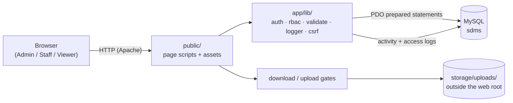
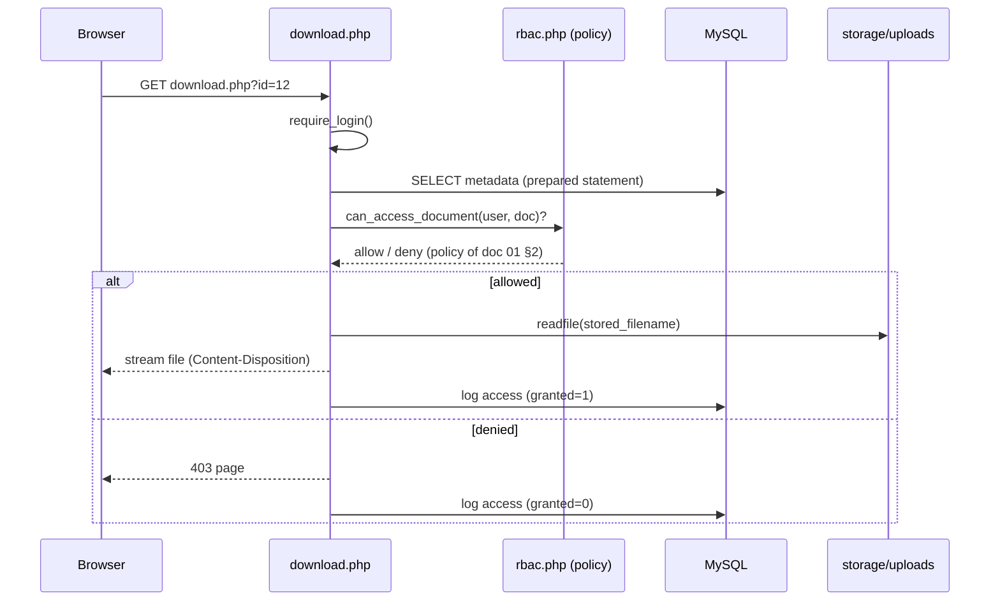
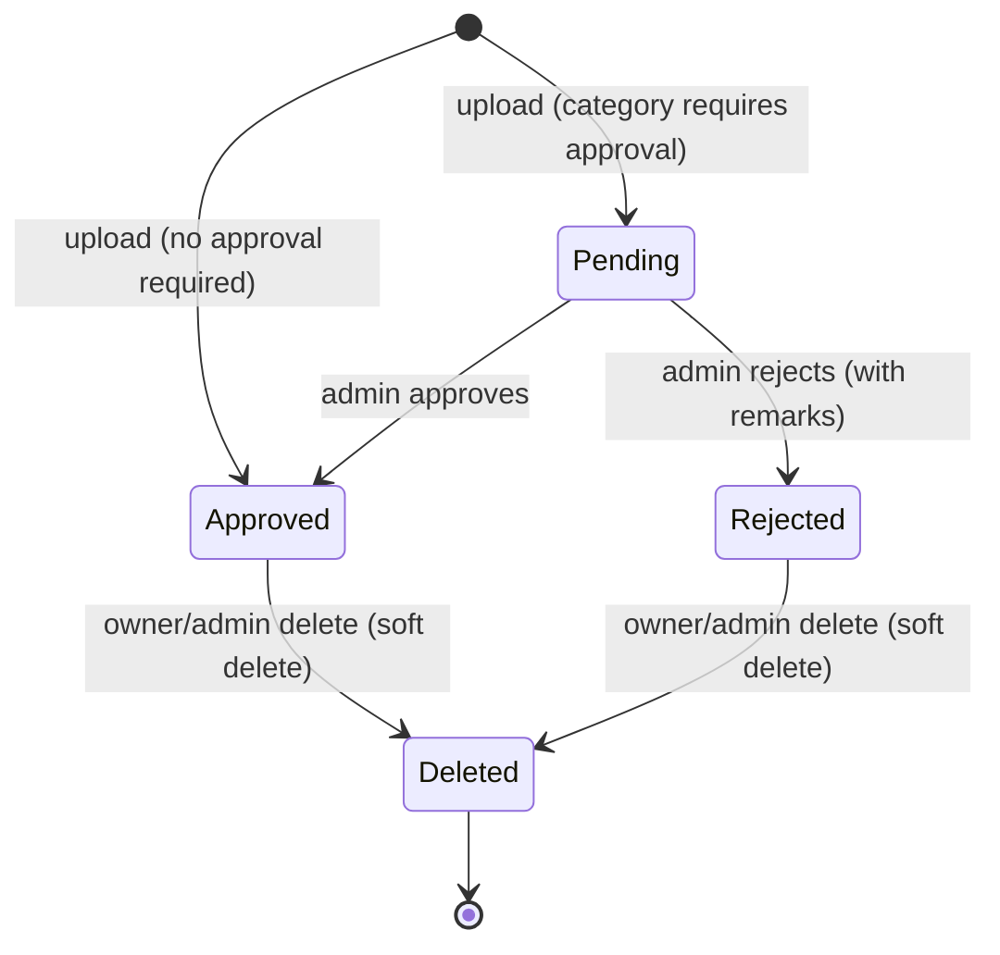

# 02 · System Architecture

**Secure Document Management System — ITEC 85 (Information Security)**

A pragmatic, security-first architecture that builds directly on what the team already knows from the
ITEC labs: **PHP 8 + MySQL on XAMPP**, no framework, organized with shared libraries instead.

> **In plain words:** "architecture" is the floor plan of the app. The browser can only ever see the
> `public/` folder; `app/` holds the brain (login checks, database access, logging); uploaded files sit
> in `storage/uploads/` where no web address can reach them; and everything about users and documents
> is written down in the MySQL database called `sdms`. Reading this page once will save you hours of
> "which file is what?"

---

## 1. Technology Stack & Rationale

| Layer | Technology | Rationale |
|-------|------------|-----------|
| Presentation | HTML5 + Bootstrap 5 (CDN) + vanilla JS | Responsive admin-style UI fast; no build step |
| Application | Plain PHP 8.x with shared libraries | Matches lab experience; fewer moving parts; full control over security code — which is the point of this course |
| Data | MySQL / MariaDB (InnoDB, utf8mb4) | Matches lab experience; FKs + transactions needed for SR-10 |
| Web server | Apache (XAMPP) | `.htaccess` hardening for the uploads folder |
| Storage | Filesystem (`storage/uploads/`) + metadata in MySQL | Binary files in the DB would bloat it; checksum stored for integrity |
| Collaboration | Git + GitHub | Contribution evidence and code review |

---

## 2. High-Level View



Key decision: **only `public/` is web-visible.** Uploaded files live in `storage/uploads/` (a sibling of
`public/`), so there is no URL that serves a file directly — every byte passes through the download gate
where authentication, RBAC, and the access policy are enforced (SR-2, SR-3, SR-4).

---

## 3. Folder Structure

```
SDMS/
├── public/                     # ← Apache serves only this subtree
│   ├── index.php               # entry: redirect to login or dashboard
│   ├── login.php · logout.php
│   ├── dashboard.php           # role-aware landing page
│   ├── profile.php
│   ├── documents/
│   │   ├── index.php           # list + search + filter (role-aware)
│   │   ├── upload.php          # staff/admin only
│   │   ├── view.php            # metadata + preview link
│   │   ├── download.php        # the gated download endpoint
│   │   ├── edit.php · delete.php
│   │   └── history.php         # own upload history (FR-14)
│   ├── admin/
│   │   ├── dashboard.php       # stats (FR-19)
│   │   ├── users.php           # account CRUD + activate/deactivate
│   │   ├── categories.php      # category management
│   │   ├── approvals.php       # review / approve / reject queue
│   │   ├── logs.php            # activity + access log viewer
│   │   └── reports.php         # generate + print reports
│   └── assets/
│       ├── css/ · js/ · img/
├── app/
│   ├── config/
│   │   ├── config.sample.php   # committed template
│   │   └── config.php          # real credentials (gitignored)
│   ├── bootstrap.php           # session config, autoload libs, error handling
│   └── lib/
│       ├── db.php              # PDO singleton (ERRMODE_EXCEPTION, utf8mb4)
│       ├── auth.php            # require_login(), current_user(), login/logout logic
│       ├── rbac.php            # require_role(), can_access_document() policy
│       ├── validate.php        # input validators, file type/size checks (finfo)
│       ├── csrf.php            # csrf_token(), csrf_verify()
│       ├── logger.php          # log_activity(), log_access()
│       ├── flash.php           # one-shot success/error messages
│       └── helpers.php         # e(), redirect(), base_url(), formatting
├── database/
│   ├── schema.sql              # CREATE DATABASE/TABLEs (see doc 03)
│   └── seed.sql                # roles, categories, initial admin
├── storage/
│   └── uploads/                # server-generated filenames; .htaccess blocks execution
├── logs/                       # optional file logs (audit data lives in MySQL)
├── docs/                       # this documentation set
└── README.md
```

---

## 4. Modules

| Module | Files | Owner (suggested) |
|--------|-------|-------------------|
| Authentication & profile | `login.php`, `logout.php`, `profile.php`, `lib/auth.php` | Kim |
| RBAC & access policy | `lib/rbac.php`, guards in every page | Kim + Denise |
| User management | `admin/users.php` | Elijah |
| Categories | `admin/categories.php` | Elijah |
| Documents (upload/search/view/edit/delete/history) | `documents/*` | Edcel |
| Download gate & upload validation | `documents/download.php`, `documents/upload.php`, `lib/validate.php` | Edcel + Denise |
| Approval workflow | `admin/approvals.php`, status transitions | Elijah |
| Dashboard & reports | `admin/dashboard.php`, `admin/reports.php`, `dashboard.php` | Sofia |
| Audit logging | `lib/logger.php`, `admin/logs.php` | Denise |
| Frontend / UI | `assets/`, views in all modules | Mycah, Sofia |
| Database schema | `database/*.sql` | Dyna |

---

## 5. Request Lifecycle

1. Apache maps every request into `public/`.
2. Page script includes `app/bootstrap.php` → hardened session start (HttpOnly, SameSite=Lax), config, libs, friendly error handler (details to `logs/`, generic message to user).
3. Guard: `require_login()` — logged-out users redirect to `login.php` (SR-2).
4. Authorization: `require_role([...])` or `can_access_document()` — deny by default, log denials (SR-3, SR-4).
5. Input: validate POST/GET with `lib/validate.php`; verify CSRF token on every POST (SR-6).
6. Data: PDO prepared statements only (SR-5); transactions wrap multi-step writes (SR-10).
7. Response: render view with `e()`-escaped output (XSS); flash message confirms the action.
8. Audit: `log_activity()` records who did what, when, from which IP (SR-8).

---

## 6. Upload & Download Data Flow

**Upload (staff):** validate size ≤ 10 MB → whitelist extension → `finfo` MIME check → reject anything
executable → save with a random server-generated name (`bin2hex(random_bytes(16))`) → compute SHA-256 →
insert metadata row (status = `pending` if the category requires approval, else `approved`) → log.

**Download gate (`documents/download.php`):**



The stored filename is never user-controlled, so path traversal through the download URL is impossible
by design (SR-4, SR-6).

---

## 7. Approval Workflow



Only Pending/Rejected documents are restricted: the owner and admins can open them; everyone else is
blocked at the download gate (full policy table in `docs/01-REQUIREMENTS.md` §2).

---

## 8. Error Handling & Logging

- PHP errors/exceptions: caught by `bootstrap.php`; full details go to `logs/app-YYYY-MM-DD.log`; the
  user sees a generic, friendly message — never a MySQL error or stack trace (SR-4, SR-6).
- Expected user errors (bad input, denied access): inline flash messages.
- Audit trail is append-only in MySQL (SR-8); the UI exposes **no** edit or delete for logs.

## 9. Security Architecture Decisions (summary)

1. Files outside the web root; downloads only through the PHP gate.
2. Deny-by-default RBAC guard at the top of every page.
3. Prepared statements everywhere; no dynamic SQL concatenation.
4. CSRF token on every state-changing form; escaped output everywhere.
5. Hardened sessions: regeneration on login, idle timeout, HttpOnly + SameSite cookie.
6. Random stored filenames + SHA-256 checksums for integrity (SR-10).

Full playbook and tests: `docs/04-SECURITY-PLAN.md`.
