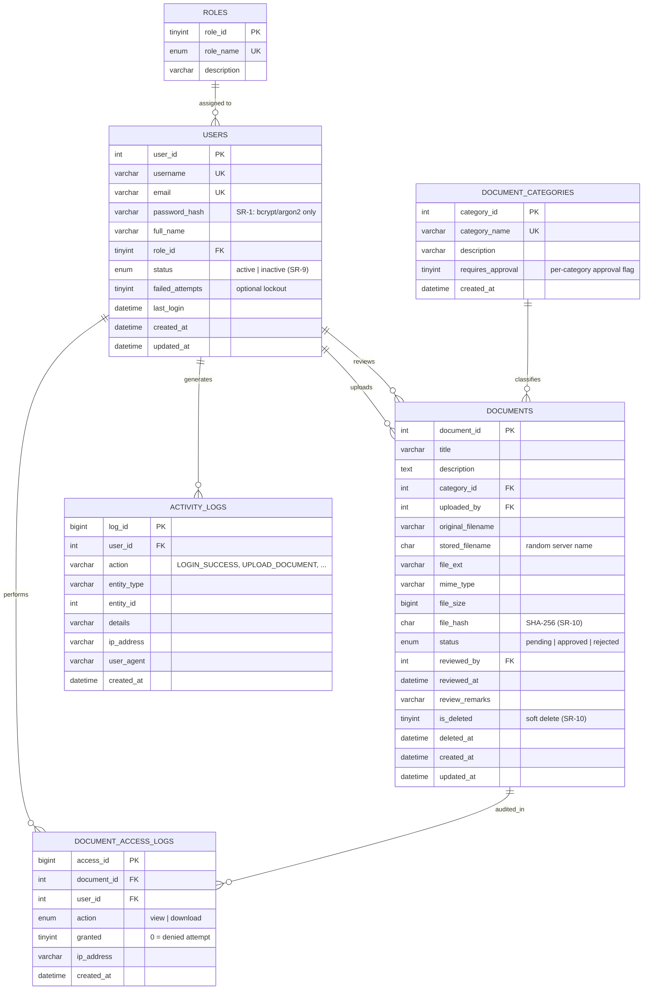

# 03 · Database Design

**Secure Document Management System — ITEC 85 (Information Security)**

Database: `sdms` — MySQL/MariaDB (XAMPP), InnoDB engine, `utf8mb4` so Filipino names like
*Peñaflor* store and display correctly.

> **In plain words:** a database is a set of "smart spreadsheets" (tables) — one for users, one for
> documents, one for categories, one for logs — that refer to each other by ID. This page has three
> parts: (1) a **map** of the tables (the ERD), (2) the **columns** of each table, (3) the
> **ready-made script** that builds everything. You do not type any of this by hand: create an empty
> database named `sdms` in phpMyAdmin, click **Import**, and load `database/schema.sql` then
> `database/seed.sql` — done.

---

## 1. ERD



---

## 2. Table Specifications

### 2.1 `roles` — the three roles from manual §D
| Column | Type | Notes |
|--------|------|-------|
| role_id | TINYINT UNSIGNED PK AI | 1=admin, 2=staff, 3=viewer (seeded) |
| role_name | ENUM('admin','staff','viewer') UNIQUE | checked in code as-is |
| description | VARCHAR(100) | human-readable summary |

### 2.2 `users`
| Column | Type | Notes |
|--------|------|-------|
| user_id | INT UNSIGNED PK AI | |
| username | VARCHAR(50) UNIQUE | login identifier |
| email | VARCHAR(100) UNIQUE | |
| password_hash | VARCHAR(255) | `password_hash()` output — **never** plaintext (SR-1) |
| full_name | VARCHAR(100) | |
| role_id | FK → roles | RBAC (SR-3) |
| status | ENUM('active','inactive') DEFAULT 'active' | deactivation blocks login instantly (SR-9) |
| failed_attempts | TINYINT UNSIGNED DEFAULT 0 | optional lockout support (enhancement) |
| last_login | DATETIME NULL | |
| created_at / updated_at | TIMESTAMP | |

### 2.3 `document_categories`
| Column | Type | Notes |
|--------|------|-------|
| category_id | INT UNSIGNED PK AI | |
| category_name | VARCHAR(80) UNIQUE | e.g., *Research Papers* |
| description | VARCHAR(255) | |
| requires_approval | TINYINT(1) DEFAULT 0 | manual: approval "if required" (FR-30) |

### 2.4 `documents`
| Column | Type | Notes |
|--------|------|-------|
| document_id | INT UNSIGNED PK AI | |
| title | VARCHAR(150) | searchable |
| description | TEXT | searchable |
| category_id | FK → document_categories | |
| uploaded_by | FK → users | owner |
| original_filename | VARCHAR(255) | shown to users |
| stored_filename | CHAR(64) | random hex name on disk — never user-controlled (SR-4) |
| file_ext / mime_type | VARCHAR | validated against whitelist (SR-6) |
| file_size | BIGINT UNSIGNED | bytes |
| file_hash | CHAR(64) | SHA-256 of content — integrity check (SR-10) |
| status | ENUM('pending','approved','rejected') DEFAULT 'pending' | approval workflow |
| reviewed_by | FK → users NULL | admin who reviewed |
| reviewed_at / review_remarks | DATETIME / VARCHAR(255) | rejection reason (FR-16) |
| is_deleted / deleted_at | TINYINT(1) / DATETIME | soft delete (SR-10) |
| created_at / updated_at | TIMESTAMP | upload history (FR-14) |

### 2.5 `activity_logs` — append-only audit trail (SR-8)
| Column | Type | Notes |
|--------|------|-------|
| log_id | BIGINT UNSIGNED PK AI | |
| user_id | FK → users NULL | NULL = anonymous/failed-login attempt |
| action | VARCHAR(100) | e.g. `LOGIN_SUCCESS`, `LOGIN_FAILED`, `UPLOAD_DOCUMENT`, `DOWNLOAD_DOCUMENT`, `EDIT_DOCUMENT`, `DELETE_DOCUMENT`, `APPROVE_DOCUMENT`, `REJECT_DOCUMENT`, `CREATE_USER`, `DEACTIVATE_USER`, `CREATE_CATEGORY`, `ACCESS_DENIED` |
| entity_type / entity_id | VARCHAR(50) / INT | what the action touched |
| details | VARCHAR(255) | short human-readable context |
| ip_address | VARCHAR(45) | IPv4/IPv6 |
| user_agent | VARCHAR(255) | browser fingerprint |
| created_at | TIMESTAMP | |

### 2.6 `document_access_logs` — per-document monitoring (FR-28)
| Column | Type | Notes |
|--------|------|-------|
| access_id | BIGINT UNSIGNED PK AI | |
| document_id | FK → documents | |
| user_id | FK → users NULL | |
| action | ENUM('view','download') | |
| granted | TINYINT(1) DEFAULT 1 | **0 records denied attempts** — evidence of probing |
| ip_address / created_at | | |

### 2.7 `login_attempts` *(optional — login throttling)*
| Column | Type | Notes |
|--------|------|-------|
| attempt_id | BIGINT UNSIGNED PK AI | |
| username_tried | VARCHAR(100) | as typed (no FK) |
| ip_address / success / created_at | | supports "N failures in M minutes → temporary lock" |

---

## 3. Schema DDL (`database/schema.sql`)

```sql
-- The shipped file no longer contains CREATE DATABASE / USE / DROP DATABASE:
-- free staging hosts (InfinityFree) disable them. Create/select the database
-- first (localhost: `sdms`; staging: the panel database, doc 09 Step 2),
-- then import — the tables land inside the selected database.

CREATE TABLE roles (
  role_id     TINYINT UNSIGNED AUTO_INCREMENT PRIMARY KEY,
  role_name   ENUM('admin','staff','viewer') NOT NULL UNIQUE,
  description VARCHAR(100) NOT NULL
) ENGINE=InnoDB;

CREATE TABLE users (
  user_id         INT UNSIGNED AUTO_INCREMENT PRIMARY KEY,
  username        VARCHAR(50)  NOT NULL UNIQUE,
  email           VARCHAR(100) NOT NULL UNIQUE,
  password_hash   VARCHAR(255) NOT NULL,
  full_name       VARCHAR(100) NOT NULL,
  role_id         TINYINT UNSIGNED NOT NULL,
  status          ENUM('active','inactive') NOT NULL DEFAULT 'active',
  failed_attempts TINYINT UNSIGNED NOT NULL DEFAULT 0,
  last_login      DATETIME NULL,
  created_at      TIMESTAMP NOT NULL DEFAULT CURRENT_TIMESTAMP,
  updated_at      TIMESTAMP NOT NULL DEFAULT CURRENT_TIMESTAMP ON UPDATE CURRENT_TIMESTAMP,
  CONSTRAINT fk_users_role FOREIGN KEY (role_id) REFERENCES roles(role_id)
) ENGINE=InnoDB;

CREATE TABLE document_categories (
  category_id       INT UNSIGNED AUTO_INCREMENT PRIMARY KEY,
  category_name     VARCHAR(80) NOT NULL UNIQUE,
  description       VARCHAR(255) NULL,
  requires_approval TINYINT(1) NOT NULL DEFAULT 0,
  created_at        TIMESTAMP NOT NULL DEFAULT CURRENT_TIMESTAMP
) ENGINE=InnoDB;

CREATE TABLE documents (
  document_id       INT UNSIGNED AUTO_INCREMENT PRIMARY KEY,
  title             VARCHAR(150) NOT NULL,
  description       TEXT NULL,
  category_id       INT UNSIGNED NOT NULL,
  uploaded_by       INT UNSIGNED NOT NULL,
  original_filename VARCHAR(255) NOT NULL,
  stored_filename   CHAR(64) NOT NULL,
  file_ext          VARCHAR(10)  NOT NULL,
  mime_type         VARCHAR(100) NOT NULL,
  file_size         BIGINT UNSIGNED NOT NULL,
  file_hash         CHAR(64) NOT NULL,
  status            ENUM('pending','approved','rejected') NOT NULL DEFAULT 'pending',
  reviewed_by       INT UNSIGNED NULL,
  reviewed_at       DATETIME NULL,
  review_remarks    VARCHAR(255) NULL,
  is_deleted        TINYINT(1) NOT NULL DEFAULT 0,
  deleted_at        DATETIME NULL,
  created_at        TIMESTAMP NOT NULL DEFAULT CURRENT_TIMESTAMP,
  updated_at        TIMESTAMP NOT NULL DEFAULT CURRENT_TIMESTAMP ON UPDATE CURRENT_TIMESTAMP,
  CONSTRAINT fk_docs_category FOREIGN KEY (category_id) REFERENCES document_categories(category_id),
  CONSTRAINT fk_docs_uploader FOREIGN KEY (uploaded_by)  REFERENCES users(user_id),
  CONSTRAINT fk_docs_reviewer FOREIGN KEY (reviewed_by)  REFERENCES users(user_id),
  INDEX idx_docs_status   (status),
  INDEX idx_docs_category (category_id),
  INDEX idx_docs_uploader (uploaded_by),
  INDEX idx_docs_title    (title)
) ENGINE=InnoDB;

CREATE TABLE activity_logs (
  log_id      BIGINT UNSIGNED AUTO_INCREMENT PRIMARY KEY,
  user_id     INT UNSIGNED NULL,
  action      VARCHAR(100) NOT NULL,
  entity_type VARCHAR(50)  NULL,
  entity_id   INT UNSIGNED NULL,
  details     VARCHAR(255) NULL,
  ip_address  VARCHAR(45)  NULL,
  user_agent  VARCHAR(255) NULL,
  created_at  TIMESTAMP NOT NULL DEFAULT CURRENT_TIMESTAMP,
  CONSTRAINT fk_logs_user FOREIGN KEY (user_id) REFERENCES users(user_id),
  INDEX idx_logs_created (created_at),
  INDEX idx_logs_action  (action),
  INDEX idx_logs_user    (user_id)
) ENGINE=InnoDB;

CREATE TABLE document_access_logs (
  access_id   BIGINT UNSIGNED AUTO_INCREMENT PRIMARY KEY,
  document_id INT UNSIGNED NOT NULL,
  user_id     INT UNSIGNED NULL,
  action      ENUM('view','download') NOT NULL,
  granted     TINYINT(1) NOT NULL DEFAULT 1,
  ip_address  VARCHAR(45) NULL,
  created_at  TIMESTAMP NOT NULL DEFAULT CURRENT_TIMESTAMP,
  CONSTRAINT fk_alog_doc  FOREIGN KEY (document_id) REFERENCES documents(document_id),
  CONSTRAINT fk_alog_user FOREIGN KEY (user_id)     REFERENCES users(user_id),
  INDEX idx_alog_doc     (document_id),
  INDEX idx_alog_created (created_at)
) ENGINE=InnoDB;

-- Optional (login throttling enhancement)
CREATE TABLE login_attempts (
  attempt_id     BIGINT UNSIGNED AUTO_INCREMENT PRIMARY KEY,
  username_tried VARCHAR(100) NOT NULL,
  ip_address     VARCHAR(45)  NOT NULL,
  success        TINYINT(1)   NOT NULL DEFAULT 0,
  created_at     TIMESTAMP NOT NULL DEFAULT CURRENT_TIMESTAMP,
  INDEX idx_attempt (username_tried, created_at)
) ENGINE=InnoDB;
```

---

## 4. Seed Data (`database/seed.sql`)

Ready-to-import versions of both files live in `database/schema.sql` and `database/seed.sql` in the
repo — students only ever click **Import** in phpMyAdmin. The snippets below show what they contain.

```sql
INSERT INTO roles (role_name, description) VALUES
('admin',  'Administrator - full control of users, documents, and settings'),
('staff',  'Employee - uploads, organizes, and updates documents'),
('viewer', 'Viewer - can only view and download authorized documents');

-- Three demo accounts, one per role — passwords for testing:
--   admin / Admin@123 · staff / Staff@123 · viewer / Viewer@123 (change after first login)
-- Only bcrypt hashes are stored (SR-1) — the real hashes are in database/seed.sql.
INSERT INTO users (username, email, password_hash, full_name, role_id) VALUES
('admin',  'admin@sdms.local',  '<bcrypt hash of Admin@123>',  'System Administrator', 1),
('staff',  'staff@sdms.local',  '<bcrypt hash of Staff@123>',  'Demo Staff User',      2),
('viewer', 'viewer@sdms.local', '<bcrypt hash of Viewer@123>', 'Demo Viewer User',     3);

INSERT INTO document_categories (category_name, description, requires_approval) VALUES
('Assignments',      'Class assignments and homework',      0),
('Research Papers',  'Studies and formal research',         1),
('Project Documents','Group project files',                 1),
('Reports',          'Reports and summaries',               0),
('Others',           'Uncategorized school materials',      0);
```

---

## 5. Design Decisions

| Decision | Why |
|----------|-----|
| File bytes on disk, metadata in MySQL | Keeps the DB small; downloads stream via the PHP gate where access control runs |
| Random `stored_filename` + kept `original_filename` | No user-controlled paths (SR-4); users still see real names on download |
| SHA-256 `file_hash` per document | Detects tampering / accidental corruption (SR-10) |
| `status` ENUM on documents | Straightforward approval workflow matching manual §C |
| `requires_approval` per category | Manual says approval applies only "if approval is required" |
| Soft delete (`is_deleted`) | Data integrity & recoverability (SR-10); reports stay meaningful |
| Append-only log tables | SR-8 — the application exposes no edit/delete path for logs |
| ENUMs + foreign keys | Controlled vocabulary; the DB itself blocks orphaned/invalid rows (SR-10) |
| `utf8mb4` everywhere | Correct storage of ñ and other characters (NFR-8) |
| `login_attempts` optional table | SR-2 enhancement: temporary lockout after repeated failures |

## 6. Integrity & Maintenance Notes

- All multi-step writes (e.g., insert document + write log) run inside a transaction (`$pdo->beginTransaction()`).
- Queries filter deleted rows with `WHERE is_deleted = 0`; "Delete" only flips the flag.
- Indexes above cover the search/filter patterns (title LIKE, category, status, uploader, date).
- Backup procedure (NFR-7): `mysqldump -u root sdms > backup.sql` + copy of `storage/uploads/`.
